# GymFlow logical DER — client demo v1

This is the readable core view. The full physical schema is split by domain in `database/`.

```mermaid
erDiagram
  ORGANIZATIONS ||--o{ BRANCHES : has
  ORGANIZATIONS ||--o{ PEOPLE : owns
  ORGANIZATIONS ||--o{ USER_ORGANIZATIONS : grants_access
  USERS ||--o{ USER_ORGANIZATIONS : joins
  USER_ORGANIZATIONS ||--o{ USER_ROLES : has
  ROLES ||--o{ USER_ROLES : assigned
  ROLES ||--o{ ROLE_PERMISSIONS : grants
  PERMISSIONS ||--o{ ROLE_PERMISSIONS : included

  PEOPLE ||--o| EMPLOYEES : may_be
  PEOPLE ||--o| MEMBERS : may_be
  PEOPLE ||--o{ PROSPECTS : may_enter_funnel
  PROSPECTS o|--o| MEMBERS : converts_to

  PLANS ||--o{ PLAN_VERSIONS : versions
  MEMBERS ||--o{ MEMBERSHIPS : contracts
  PLAN_VERSIONS ||--o{ MEMBERSHIPS : selected
  MEMBERSHIPS o|--o{ MEMBERSHIP_FREEZES : may_freeze

  MEMBERS ||--o{ RECEIVABLES : owes
  MEMBERSHIPS o|--o{ RECEIVABLES : generates
  PAYMENTS ||--|{ PAYMENT_SPLITS : paid_with
  PAYMENT_METHODS ||--o{ PAYMENT_SPLITS : method
  PAYMENTS ||--o{ PAYMENT_ALLOCATIONS : allocates
  RECEIVABLES ||--o{ PAYMENT_ALLOCATIONS : receives
  CASH_REGISTERS ||--o{ CASH_SHIFTS : opens
  CASH_SHIFTS ||--o{ CASH_MOVEMENTS : contains
  PAYMENT_SPLITS o|--o| CASH_MOVEMENTS : cash_only
  ORGANIZATIONS ||--o{ SHIFT_HANDOFFS : owns
  BRANCHES ||--o{ SHIFT_HANDOFFS : occurs_at
  EMPLOYEES ||--o{ SHIFT_HANDOFFS : hands_off
  EMPLOYEES o|--o{ SHIFT_HANDOFFS : receives
  CASH_SHIFTS o|--o{ SHIFT_HANDOFFS : optional_context
  USER_ORGANIZATIONS ||--o{ SHIFT_HANDOFFS : creates
  MEMBERS o|--o{ SUPPORT_TICKETS : concerns
  ORDERS ||--o{ PRODUCT_RETURNS : preserves_sale
  ORDER_ITEMS ||--o{ PRODUCT_RETURNS : returns_quantity
  PAYMENTS ||--o{ REFUNDS : reimburses
  PAYMENT_SPLITS o|--o{ REFUNDS : original_medium
  PRODUCT_RETURNS o|--o{ REFUNDS : reimbursed_by

  MEMBERS ||--o{ ATTENDANCE_EVENTS : enters
  TRAINER_PROFILES ||--o{ TRAINER_MEMBER_ASSIGNMENTS : coaches
  MEMBERS ||--o{ TRAINER_MEMBER_ASSIGNMENTS : assigned
  MEMBERS ||--o{ PROGRESS_REVIEWS : reviewed
  CLASSES ||--o{ CLASS_SESSIONS : schedules
  CLASS_SESSIONS ||--o{ CLASS_RESERVATIONS : receives
  MEMBERS ||--o{ CLASS_RESERVATIONS : books

  PRODUCTS ||--o{ INVENTORY_BALANCES : balances
  PRODUCTS ||--o{ INVENTORY_MOVEMENTS : ledger
  MEMBERS ||--o| POINT_ACCOUNTS : owns
  POINT_ACCOUNTS ||--o{ POINT_TRANSACTIONS : ledger
  REWARDS ||--o{ REWARD_REDEMPTIONS : redeemed
  MEMBERS ||--o{ REWARD_REDEMPTIONS : requests

  AUTOMATIONS ||--o{ JOBS : creates
  JOBS ||--o{ EXECUTIONS : runs
  ORGANIZATIONS ||--o{ AUDIT_LOGS : audits
```

## Critical invariants

1. Tenant-owned entities are scoped by `OrganizationId`.
2. Historical finance/membership records are retained, not overwritten/deleted casually.
3. `Payment` is one business receipt; `PaymentSplit` describes how it was paid.
4. Only cash payment splits affect a cash shift.
5. Membership price is snapshotted from the selected plan version.
6. A prospect conversion keeps the original CRM history.
7. Access exception approval is not attendance; an entry event is required.
8. Points and stock have ledgers plus current read/cache balances for fast queries.
9. Handoff is independent of cash closure. Tenant-scoped references and branch checks prevent cross-organization handoffs; rowversion protects transitions and prior records remain immutable.
10. A processed product return links to the original payment split/order, restores inventory through a movement, and creates a cash outflow only when reimbursing cash. Nullable references preserve legacy refunds; new POS refund processing requires both references.

The only new table authorized for Reception closure is `core.ShiftHandoffs`. Exact SQL, indexes, tests and limitations: [Reception closure report](RECEPTION_CLOSURE_REPORT.md).
